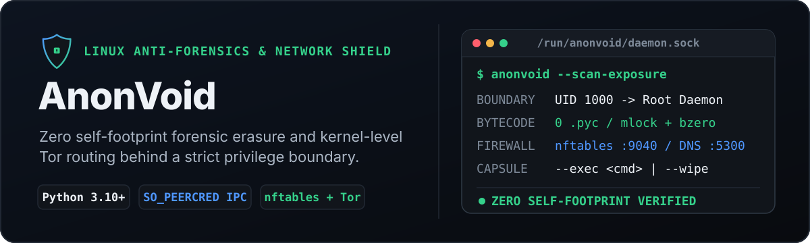
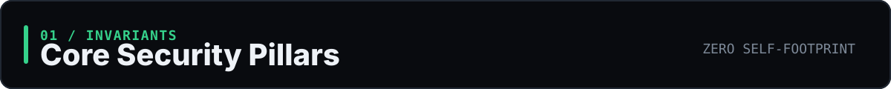
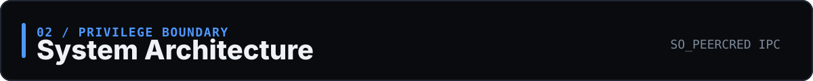
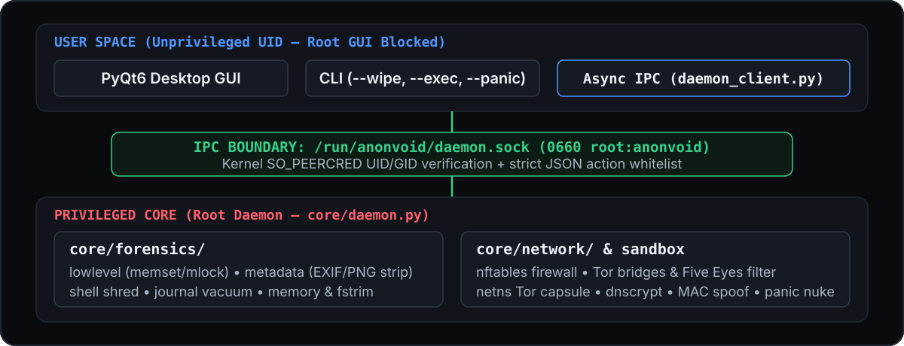
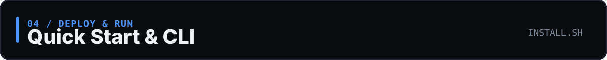

<p align="center">
  
</p>

<p align="center">
  <a href="https://github.com/ali0zdas/AnonVoid"></a>
  <a href="LICENSE"></a>
  <a href="https://www.python.org/"></a>
  <a href="https://www.kali.org/"></a>
  <a href="https://github.com/ali0zdas/AnonVoid"></a>
</p>

<p align="center">
  <b>Zero Self-Footprint. Kernel-Verified Privilege Separation. Uncompromising Digital Forensics Erasure &amp; Tor Shield.</b>
</p>

---

## Overview

**AnonVoid** (`anonvoid`) is an open-source anti-forensics cleaner and transparent network privacy shield built for Linux security workflows (Kali Linux, Debian, Ubuntu, Arch Linux, and Fedora). It removes digital traces across shell histories, system logs, desktop artifacts, metadata, RAM, and storage—while transparently routing outbound traffic through Tor and DNSCrypt at the kernel firewall level (`nftables` / `iptables`).

Unlike conventional cleanup scripts, AnonVoid is engineered around two strict invariants: **Zero Self-Footprint** (never writing bytecode caches or temp artifacts to disk) and a **Privilege Boundary** that isolates the unprivileged desktop GUI/CLI from the root daemon.

---

<p align="center">
  
</p>

| Principle | Implementation & Technical Standard |
| :--- | :--- |
| **Zero Self-Footprint** | Python bytecode emission is disabled (`sys.dont_write_bytecode = True`, `PYTHONDONTWRITEBYTECODE=1`). Sensitive memory regions are wiped with `libc.memset` / `explicit_bzero` and locked against swap via `mlock`. |
| **Privilege Separation** | The PyQt6 GUI **never runs as root or sudo** (`os.getuid() == 0` is blocked) to protect Wayland/X11 sessions. Privileged actions are executed exclusively by the root daemon over `/run/anonvoid/daemon.sock`. |
| **Kernel-Verified IPC (`SO_PEERCRED`)** | The daemon reads the caller's real UID/GID directly from the Linux kernel via `SO_PEERCRED` rather than trusting client claims. Only authorized users and whitelisted JSON actions are accepted. |
| **Strict Schema & `O_NOFOLLOW`** | File operations open targets with `os.O_NOFOLLOW` to block symlink race attacks. Ports and UIDs undergo strict range and ASCII decimal validation. |
| **Anti-Anomaly Log Hygiene** | System logs are never blindly truncated to 0 bytes; `journalctl --vacuum-time=1s` and `logrotate -f` preserve normal system appearance. |

---

<p align="center">
  
</p>

AnonVoid enforces a two-tier boundary between the unprivileged user interface and the privileged system core:

<p align="center">
  
</p>

---

<p align="center">
  
</p>

### 1. Forensics Core (`core/forensics/`)
* **Shell & REPL History Shredding:** Multi-pass overwrite (`/dev/urandom` and `0x00`) for `bash`, `zsh`, `fish`, `python`, `mysql`, `psql`, and `node` histories.
* **Dependency-Free Metadata Stripping:** Pure-Python atomic sanitization of PNG (`tEXt`, `zTXt`, `iTXt`, `eXIf`, `tIME`) and JPEG (`APP1/EXIF`, `APP13/IPTC`, `COM`) chunks, rejecting symlinks via `O_NOFOLLOW`.
* **Live Forensic Exposure Radar:** Read-only scanner evaluating shell histories, thumbnails, and caches to compute a `0–100` risk score (`LOW`, `MEDIUM`, `HIGH`, `CRITICAL`).
* **System & Session Logs:** Vacuums `systemd-journald`, rotates `/var/log/*` remnants, and sanitizes `wtmp`, `btmp`, and `lastlog`.
* **Desktop & Browser Caches:** Clears XDG `thumbnails`, `recently-used.xbel`, `Trash`, and Chromium/Firefox disk caches.
* **RAM & Swap Hygiene:** Flushes Linux pagecache/dentries/inodes (`drop_caches`), compacts memory, cycles `swapoff` to wipe swap, and sets `prctl(PR_SET_DUMPABLE, 0)` against `ptrace`/core dumps.
* **Storage & SSD/NVMe Blocks:** Detects SSD hardware (`/sys/block`), triggers `fstrim -av` for FTL wear-leveling mitigation, and supports free-space zeroing.
* **Package Managers & Sandboxes:** Cleans APT, Pacman, DNF, Zypper caches alongside Flatpak and Snap remnants.

### 2. Network & Privacy Stack (`core/network/`)
* **Kernel Firewall (`nftables` / `iptables`):** Redirects outbound TCP to Tor `TransPort` (`9040`) and DNS to Tor `DNSPort` (`5300`), enforcing DNS redirection ahead of local LAN exceptions.
* **UDP & ICMP Leak Prevention:** Drops outbound UDP and ICMP packets in the egress chain to eliminate WebRTC STUN and QUIC leaks.
* **Per-App Tor Capsule (`NetNS` & `Torsocks`):** Runs a single command in an isolated Tor network namespace (`anonvoid --exec <cmd>`) without routing the entire host, dropping privileges back to the target UID.
* **Tor Bridges & Five Eyes Exclusion:** Supports `obfs4` and `snowflake` pluggable transports, plus optional exclusion of Five Eyes exit nodes (`{us},{gb},{ca},{au},{nz}`).
* **DoH / DoT & IPv6 Shield:** Drops port `443` traffic to public DoH resolvers (`1.1.1.1`, `8.8.8.8`, `9.9.9.9`) and blocks all outbound `ip6` traffic.
* **Loop Prevention & `.onion` Routing:** Exempts `debian-tor` via `meta skuid` and routes `10.192.0.0/10` directly into the Tor tunnel.
* **In-Place MAC Spoofing & Leak Test:** Spoofs interface MAC addresses without racing NetworkManager, and provides one-click IP, ISP, DNS, WebRTC, and Tor exit verification.

### 3. Tactical Emergency & Hardware Kill-Switch
Triggered from the GUI panic button, CLI `--panic`, or physical removal of an authorized USB security key (`core/usb_guard.py`):
1. Immediately locks down all outbound traffic via firewall (`DROP all`).
2. Wipes active terminal sessions and shell histories.
3. Flushes Linux RAM caches.
4. Optionally executes an immediate panic shutdown.

### PyQt6 Desktop Interface & Themes
AnonVoid includes a PyQt6 desktop interface with **5 dynamic themes** tuned for low-glare and high-visibility environments:
* **OLED:** Deep dark slate (`#090b0f`) with crisp high-contrast accents.
* **Circuit:** Deep PCB emerald (`#070c0a`) with `#34d399` highlights.
* **Binary:** Cyber blue (`#00d4ff`) over deep navy surfaces.
* **Pixel:** Retro neon purple and crisp pixel-inspired accents.
* **Light:** Clean high-visibility light palette for bright environments.

---

<p align="center">
  
</p>

### Requirements
* **OS:** Kali Linux, Debian 11+, Ubuntu 20.04+, Arch Linux, Fedora 36+
* **Python:** 3.10+
* **System Packages:** `tor`, `nftables` (or `iptables`), `systemd`

### Universal Installer

```bash
git clone https://github.com/ali0zdas/AnonVoid.git
cd AnonVoid
sudo bash install.sh
```

The installer creates the `anonvoid` system group, checks dependencies (`tor`, `nftables`, `python3-pyqt6`), installs and starts `anonvoid.service`, and registers `/usr/local/bin/anonvoid` plus the `.desktop` entry.

> **Note:** Log out and back in—or run `newgrp anonvoid`—for group membership to take effect. To uninstall cleanly, run `sudo bash install.sh --uninstall`.

### CLI Usage

```bash
# Launch the PyQt6 Desktop GUI (as an unprivileged user)
anonvoid

# Tactical Clean & Exit (wipes histories, logs, and caches with zero trace)
anonvoid --wipe

# Run a single command inside an isolated Tor capsule (NetNS / Torsocks)
anonvoid --exec curl https://check.torproject.org

# Read-only forensic exposure scan (0–100 risk score)
anonvoid --scan-exposure

# Atomically strip metadata (EXIF / GPS / PNG chunks) from a file or directory
anonvoid --sanitize-meta /path/to/image_or_document.png

# Toggle the transparent network shield from the terminal
anonvoid --connect
anonvoid --disconnect

# Run a live IP / DNS / Tor leak test
anonvoid --leak-test

# Emergency Panic Mode (freeze network, flush memory)
anonvoid --panic

# Run the root daemon manually (outside systemd)
sudo anonvoid --service
```

---

## Verification & Threat Model

Run the unit test suite (covering IPC, schema validation, forensics, firewall rules, metadata stripping, USB kill-switch, and packaging) without generating bytecode:

```bash
PYTHONDONTWRITEBYTECODE=1 python3 -m pytest tests/ -q
```

1. **Wayland / X11 Root Isolation:** Blocking root execution for the GUI prevents Qt/X11/Wayland vulnerabilities from being leveraged for privilege escalation.
2. **Strict IPC Whitelisting:** The daemon accepts only schema-validated JSON actions—never arbitrary shell commands or dynamic code execution.
3. **Zero-Trace Tactical Exit:** `--wipe` cleans traces directly in memory and exits without leaving temporary sockets, PID files, or logs behind.

---

## License & Author

* **Author:** Ali Özdaş ([@ali0zdas](https://github.com/ali0zdas))
* **Repository:** [https://github.com/ali0zdas/AnonVoid](https://github.com/ali0zdas/AnonVoid)
* **License:** [GNU General Public License v3.0 (GPLv3)](LICENSE)

---

<p align="center">
  <sub>AnonVoid — Zero-Footprint Digital Forensics Eraser &amp; Transparent Network Privacy Shield.</sub>
</p>
